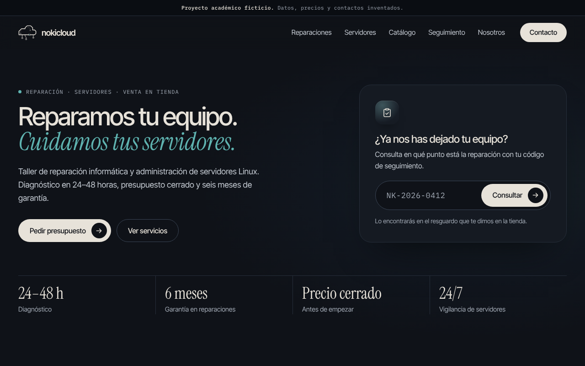

<p align="center">
  
</p>

<p align="center">
  Web de una tienda <strong>ficticia</strong> de reparación informática y administración de servidores.<br>
  Proyecto académico · HTML, CSS y JavaScript sin dependencias · Publicable en GitHub Pages.
</p>

---

> **Aviso:** NokiCloud no es una empresa real. Nombre, dirección, teléfono, precios, clientes, productos y pedidos son inventados para un trabajo de clase.



## Contenido

- [Páginas](#páginas)
- [Funcionalidades](#funcionalidades)
- [Estructura del repositorio](#estructura-del-repositorio)
- [Cómo verlo en local](#cómo-verlo-en-local)
- [Publicación en GitHub Pages](#publicación-en-github-pages)
- [Cómo personalizarlo](#cómo-personalizarlo)
- [Códigos de prueba](#códigos-de-prueba)
- [Scripts de servidores](#scripts-de-servidores)
- [Decisiones de diseño](#decisiones-de-diseño)
- [Créditos y licencias](#créditos-y-licencias)

## Páginas

| Página | Archivo | Qué contiene |
| --- | --- | --- |
| Inicio | `index.html` | Presentación breve, consulta rápida de una reparación, acceso a Reparaciones y Servidores, productos destacados y contacto. |
| Reparaciones | `reparaciones.html` | Servicios del taller, precios orientativos y preguntas frecuentes. |
| Servidores | `servidores.html` | Servicios de sistemas, planes mensuales, casos de ejemplo y preguntas frecuentes. |
| Catálogo | `catalogo.html` | Portátiles, móviles, componentes y accesorios con filtros y ficha de cada producto. La venta es en tienda. |
| Seguimiento | `seguimiento.html` | Consulta del estado de una reparación con su código. |
| Nosotros | `nosotros.html` | Quiénes somos, cómo trabajamos, dónde estamos (con mapa por rellenar) y formulario de contacto. |
| Aviso legal | `aviso-legal.html` | Aviso legal y privacidad del proyecto. Enlazado desde el pie. |
| Error 404 | `404.html` | Página que muestra GitHub Pages cuando una dirección no existe. |

## Funcionalidades

- **Navegación sencilla:** cinco apartados en el menú, botón de contacto siempre visible, migas de pan en cada página y un menú a pantalla completa en el móvil.
- **Seguimiento de reparaciones:** desde el inicio o desde su página. Admite enlaces directos como `seguimiento.html?codigo=NK-2026-0412`.
- **Catálogo** con filtros por categoría, ficha de producto en una ventana y botón para preguntar por el producto. Admite enlaces directos como `catalogo.html?categoria=telefonos` o `catalogo.html?producto=iphone-13`.
- **Formulario de contacto** con validación en el navegador. Si llegas desde un servicio, una tarifa o un producto, el formulario se rellena solo. Es una demo: no envía datos.
- **Preguntas frecuentes** desplegables en Reparaciones y Servidores.
- **Animaciones suaves** que se desactivan si el sistema tiene activada la opción de *reducir movimiento*.
- **Accesibilidad:** enlace para saltar al contenido, foco visible, etiquetas en los formularios, contraste suficiente y navegación por teclado (la ficha del catálogo se cierra con `Esc`).

## Estructura del repositorio

```text
.
├── index.html                  Inicio
├── reparaciones.html           Taller de reparaciones
├── servidores.html             Administración de servidores
├── catalogo.html               Catálogo de productos
├── seguimiento.html            Estado de una reparación
├── nosotros.html               Empresa, proceso, ubicación y contacto
├── aviso-legal.html            Aviso legal y privacidad
├── 404.html                    Página de error para GitHub Pages
├── assets/
│   ├── css/styles.css          Estilos de todas las páginas
│   ├── js/main.js              Menú, animaciones y formulario de contacto
│   ├── js/catalogo.js          Catálogo: tarjetas, filtros y ficha
│   ├── js/datos-catalogo.js    Productos del catálogo (ficticios)
│   ├── js/seguimiento.js       Lógica del seguimiento
│   ├── js/datos-reparaciones.js  Pedidos de ejemplo (ficticios)
│   ├── fonts/                  Tipografías autoalojadas (.woff2) y sus licencias
│   └── img/                    Logo y favicon en SVG
├── scripts/                    Scripts bash de administración de servidores
├── docs/                       Banner, captura, avatar y guía de publicación
├── .nojekyll                   Indica a GitHub Pages que sirva los archivos tal cual
├── .gitignore
├── LICENSE
└── README.md
```

## Cómo verlo en local

No hace falta instalar nada. Hay dos opciones:

- **Doble clic** en `index.html` para abrirlo en el navegador.
- O levantar un servidor local desde la carpeta del proyecto:

  ```bash
  python3 -m http.server 8000
  ```

  y abrir <http://localhost:8000>.

## Publicación en GitHub Pages

1. En el repositorio, entra en **Settings → Pages**.
2. En **Build and deployment → Source**, elige **Deploy from a branch**.
3. Selecciona la rama `main` y la carpeta `/ (root)` y pulsa **Save**.
4. En uno o dos minutos la web estará en `https://<tu-usuario>.github.io/<nombre-del-repo>/`.

La guía completa, paso a paso, está en [`docs/guia-github.md`](docs/guia-github.md).

## Cómo personalizarlo

**Dirección y mapa de la tienda.** Están en `nosotros.html`, en la sección *Dónde estamos*. Los textos entre corchetes, como `[Calle y número]`, son marcadores: sustitúyelos por los datos reales y borra el `<span class="placeholder">` que los rodea. Para el mapa:

1. En Google Maps, busca la dirección y pulsa **Compartir → Insertar un mapa → Copiar HTML**.
2. En `nosotros.html`, borra el bloque `<div class="map-placeholder">…</div>` y pega en su lugar el `<iframe>` copiado (dentro de `<div class="map">`).

**Productos del catálogo.** Están en `assets/js/datos-catalogo.js`. Para añadir uno, copia un bloque `{ … }` y cambia sus datos. Al principio del archivo se explica cada campo. Los marcados con `destacado: true` aparecen en el inicio.

**Pedidos de seguimiento.** Están en `assets/js/datos-reparaciones.js`.

**Teléfono, correo y horario.** Se repiten en el pie de todas las páginas. Con la función *Buscar y reemplazar en archivos* de tu editor (por ejemplo, `Ctrl + Mayús + H` en Visual Studio Code) puedes cambiarlos de una vez.

## Códigos de prueba

| Código | Equipo | Estado |
| --- | --- | --- |
| `NK-2026-0398` | Portátil HP Pavilion 15 | Entregado |
| `NK-2026-0412` | Portátil Lenovo ThinkPad T14 | En reparación |
| `NK-2026-0415` | Sobremesa a medida | Listo para recoger |
| `NK-2026-0419` | MacBook Air (M1, 2020) | Presupuesto enviado |
| `NK-2026-0421` | Servidor Dell PowerEdge T140 | Diagnóstico |

## Scripts de servidores

La carpeta [`scripts/`](scripts/) incluye dos ejemplos en bash relacionados con el servicio de administración:

- `healthcheck.sh`: revisa carga, memoria, discos y servicios sin modificar nada.
- `backup.sh`: crea copias `.tar.gz` con fecha y elimina las antiguas. Tiene un modo de simulación (`-n`).

Las instrucciones están en [`scripts/README.md`](scripts/README.md).

## Decisiones de diseño

- **Referencia visual:** la estética está inspirada en webs de estudios creativos como [Casa Numa](https://www.casanuma.biz/): fondo oscuro, texto en crema, titulares con palabras destacadas en cursiva y mucho aire. Los textos, el logo y el código son propios.
- **Páginas separadas y cortas:** cada apartado tiene su página, para que sea fácil de usar para cualquier persona. El inicio solo resume y enlaza.
- **Paleta:** la del logo original de NokiCloud. Fondo azul casi negro `#0F1218` con superficies `#151A22` y `#1B212B`, bordes `#262E3A`, texto crema `#E7E2D9`, gris azulado `#A0A8B3` para textos secundarios y verde azulado `#5FB3B0` como único acento.
- **Tipografías:** *Inter Tight* para titulares y texto, *Instrument Serif* en cursiva para las palabras destacadas e *IBM Plex Mono* para etiquetas, códigos y datos. Están autoalojadas en `assets/fonts`, así que la web no depende de Google Fonts.
- **Sin frameworks ni compilación:** cualquiera puede abrir, leer y modificar el código, y GitHub Pages lo publica directamente. Por eso la cabecera y el pie se repiten en cada archivo HTML.
- **Datos en archivos `.js`:** así el catálogo y el seguimiento funcionan también al abrir el HTML desde el disco, donde el navegador bloquea la lectura de archivos `.json`.
- **Ilustraciones propias en SVG:** los productos se muestran con dibujos genéricos, sin fotos ni logotipos de marcas.
- **Logo:** una nube trazada como pista de circuito impreso, que une las dos líneas de negocio: hardware y servidores.

## Créditos y licencias

- Código: licencia MIT. Consulta el archivo [LICENSE](LICENSE).
- Tipografías: [Inter Tight](https://fonts.google.com/specimen/Inter+Tight), [Instrument Serif](https://fonts.google.com/specimen/Instrument+Serif) e [IBM Plex Mono](https://github.com/IBM/plex), todas con licencia SIL Open Font License 1.1. Los textos de las licencias están en `assets/fonts/`.
- Los nombres de productos y marcas del catálogo pertenecen a sus propietarios y se usan solo como ejemplo.
